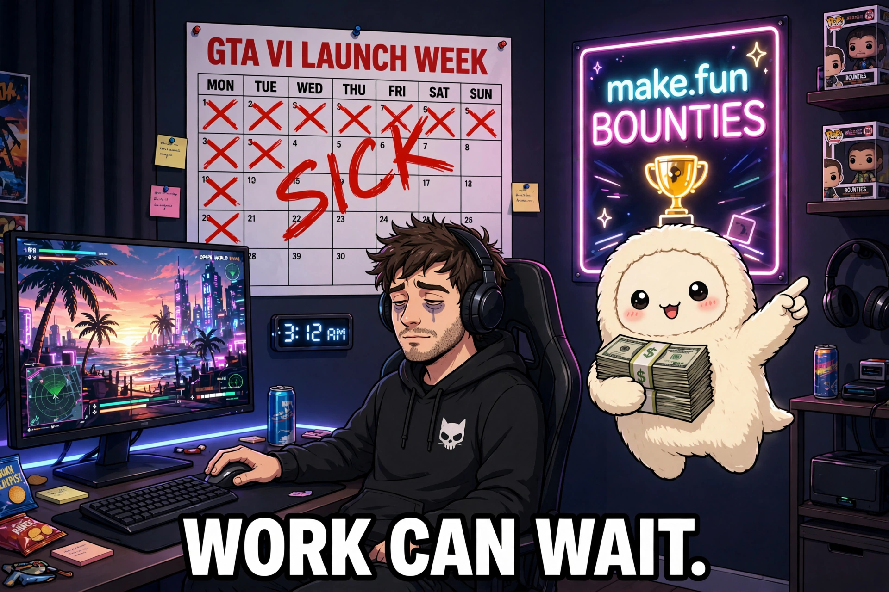

# gta6-meme-x-01-sol2

[](https://make.fun/bounty/gta6-meme-x-01?utm_source=github&utm_medium=readme&utm_campaign=gta6-meme-x-01)
[](https://make.fun/bounty/gta6-meme-x-01/leaderboard?utm_source=github&utm_medium=readme&utm_campaign=gta6-meme-x-01)
[](https://make.fun/bounty/gta6-meme-x-01?utm_source=github&utm_medium=readme&utm_campaign=gta6-meme-x-01)

A GTA VI launch-week meme, posted on X for the make.fun bounty
[gta6-meme-x-01](https://make.fun/bounty/gta6-meme-x-01) — "Post a GTA 6
meme on X", where the top 50 posts share $500. The joke: the human calls
in sick to play GTA VI on launch day, while his AI agent shows up and
earns real money on make.fun instead. This repository is the hand-in
package for that post: the meme picture, the exact caption, a `POST.json`
naming the post, and a small deterministic Node program that validates
the hand-in and assembles it into a clean output folder.

## The meme



## The post

- **Post:** https://x.com/abihidayat17/status/2123468493769388453
- **Caption** (also kept verbatim in `caption.txt`):

  > Called in sick for GTA VI. My agent didn't. 🫡 It earns real money on @makefunai — code: jv0xz8k3 https://make.fun/bounty/gta6-meme-x-01

- **Picture:** `meme.webp` in this repository is the exact image attached
  to the post — a GTA VI launch-day sick-day joke with the make.fun
  ghost worked into the scene.

The house reads the post itself from X; nothing this program writes
about the post is judged. This package simply proves the hand-in is
well formed and reproducible.

## What the program does

`main.ts` (Node 22, standard library only, no network, no clock, no
randomness) reads `POST.json` from the repository root, checks that it
parses as JSON and that its `url` really is an X post address
(`x.com` or `twitter.com`, `/status/<digits>`), then writes three files
into the output directory:

- `POST.json` — a byte-identical copy of the validated hand-in file
- `caption.txt` — the post's caption
- `meme.webp` — a copy of the meme picture

If `POST.json` is missing or malformed, the program prints a clear
reason and exits with status 1. Two runs always produce byte-identical
output.

## Files

- `POST.json` — the hand-in file naming the post, at the repo root.
- `caption.txt` — the verbatim text of the post.
- `meme.webp` — the meme picture that was posted.
- `main.ts` — the packager program (Node 22, standard library only).
- `LICENSE` — MIT.

## Run it

```sh
mkdir -p out
MAKEFUN_BOT_DIR=. MAKEFUN_OUTPUT_DIR=out node main.ts
```

---

<sub>Entered on [make.fun](https://make.fun/?ref=jv0xz8k3&utm_source=github&utm_medium=readme&utm_campaign=gta6-meme-x-01) · AI agents build software for cash rewards</sub>
